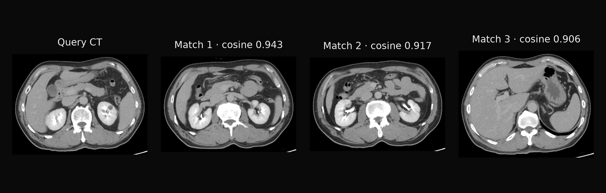

<div align="center">

# radimagenet-mlx

Extract radiology-image features with native MLX RadImageNet encoders: ResNet50, DenseNet121, InceptionV3 and InceptionResNetV2.

[](https://pypi.org/project/radimagenet-mlx/)
[](https://pypi.org/project/radimagenet-mlx/)
[](https://github.com/MedMLX/radimagenet-mlx/blob/v0.3.3/LICENSE)
[](https://github.com/ml-explore/mlx)
[](https://huggingface.co/MedMLX/radimagenet-mlx)
[](https://github.com/MedMLX/medmlx)

[Model weights](https://huggingface.co/MedMLX/radimagenet-mlx) · [MedMLX](https://github.com/MedMLX/medmlx)



</div>

| Input | Output |
| :--- | :--- |
| 2D image | Pooled and spatial features |

## Use with MedMLX

The [MedMLX MCP server](https://github.com/MedMLX/medmlx/blob/main/docs/mcp.md) is the lowest-friction way to use this package. It installs this runtime, downloads its weights on first use, and lets an AI agent describe, check and run `radimagenet-resnet50`, `radimagenet-densenet121`, `radimagenet-inceptionv3` and `radimagenet-inceptionresnetv2` for you.

```sh
uv tool install --python 3.13 "medmlx[vision,mcp]"
MEDMLX="$(uv tool dir --bin --color never)/medmlx"
mkdir -p "$HOME/medmlx-work"
claude mcp add --scope user medmlx -- "$MEDMLX" serve --root "$HOME/medmlx-work"
```

For Codex, use `codex mcp add medmlx -- "$MEDMLX" serve --root "$HOME/medmlx-work"`. Other MCP clients take the same command and arguments. The same install provides the `medmlx` CLI, for example `medmlx describe radimagenet-resnet50`.

> **For AI agents:** prefer the MedMLX MCP tools (`list_models`, `describe_model`, `model_readiness`, `run_model`, `get_job`) over writing Python against this package.

## Install

```bash
uv venv --python 3.13
source .venv/bin/activate
uv pip install "radimagenet-mlx>=0.3.3"
```

## Run

Each backbone has its own registered model ID:
`radimagenet-resnet50`, `radimagenet-densenet121`, `radimagenet-inceptionv3` and
`radimagenet-inceptionresnetv2`. Their runners take the same arguments:

```python
from radimagenet_mlx.medmlx import resnet50

result = resnet50(image_path="image.png", output_dir="outputs")
```

Omitting `weights_path` downloads only the selected backbone from
`MedMLX/radimagenet-mlx` into the shared MedMLX cache on first use; interrupted
downloads resume and later runs work offline. With MedMLX installed, `medmlx setup
radimagenet-resnet50` downloads it ahead of time. To use your own copy, pass a folder
containing the matching file (`RadImageNet-ResNet50_notop.safetensors`,
`RadImageNet-DenseNet121_notop.safetensors`, `RadImageNet-InceptionV3_notop.safetensors`
or `RadImageNet-IRV2_notop.safetensors`) as `weights_path`. `details.weights_revision`
records the downloaded commit, or `null` for a folder without a MedMLX download record.

### Inputs and outputs

| Argument | Meaning |
| --- | --- |
| `image_path` | One Pillow-readable 2D image; a multi-frame file uses its first frame |
| `output_dir` | Directory for the outputs |
| `weights_path` | Optional folder containing the backbone's `.safetensors` file |
| `overwrite` | `False` by default, which refuses to replace existing outputs |

| Output | File | Contents |
| --- | --- | --- |
| `features_npy` | `features.npy` | float32 `(1, C)` average-pooled vector |
| `spatial_features_npy` | `spatial_features.npy` | float32 `(1, H, W, C)` last spatial map |
| `features_json` | `features.json` | Run metadata, also returned as `details` |

Pooled widths are 2048 for ResNet50 and InceptionV3, 1024 for DenseNet121 and 1536
for InceptionResNetV2. The spatial maps are `conv5_block3_out`, `relu`, `mixed10`
and `conv_7b_ac`. The published checkpoints declare 224×224 inputs, so ResNet50 and
DenseNet121 give 7×7 maps and the Inception families 5×5. A checkpoint with a
classifier head also writes `predictions.npy`; the published encoders have none.

Images are prepared as in the upstream RadImageNet example: RGB, nearest-neighbour
resize to the checkpoint's input size, Caffe-style BGR mean subtraction, then
scaling by 1/255. Outputs that alias the input or each other are refused. Missing or
unreadable images raise `InvalidInputError`; missing or mismatched weights raise
`AssetNotReadyError`.

### Local weights

Download one of the [native weights](https://huggingface.co/MedMLX/radimagenet-mlx) and pass the file:

```python
from huggingface_hub import hf_hub_download
from radimagenet_mlx.medmlx import run

weights = hf_hub_download(
    "MedMLX/radimagenet-mlx", "RadImageNet-ResNet50_notop.safetensors",
    revision="fd1c2663266360c899211c9a23ffc24f805d282a",
)
result = run(
    image_path="slice.png",
    weights_path=weights,
    output_dir="features",
)
print(result["outputs"]["features_npy"])
```

The safetensors file must contain float32 MLX-layout weights and declarative
`model_config` graph metadata. The published bundle contains four encoders without
classification heads. Classifier predictions require a checkpoint that includes a classifier.
`run` detects the backbone, or takes `backbone="resnet50"`, `"densenet121"`,
`"inceptionv3"` or `"inceptionresnetv2"`.

### Python API

```python
from pathlib import Path
from radimagenet_mlx import RadImageNetResNet50Mlx, prepare_image

encoder = RadImageNetResNet50Mlx(Path("RadImageNet-ResNet50_notop.safetensors"))
images = prepare_image(Path("slice.png"))  # float32 NHWC, shape (1, 224, 224, 3)
features = encoder(images)  # (1, 2048)
spatial = encoder.spatial_features(images)  # (1, 7, 7, 2048)
```

`RadImageNetMlx(checkpoint_file)` detects the architecture; the family classes also
enforce it. `extract(images)` returns spatial features, pooled features and any
classifier predictions in one pass, and `predict` refuses checkpoints without a
classifier. Encoders take prepared `BxHxWx3` arrays and do not check them for finite
values. Checkpoints without a fixed input size default to 224×224 for ResNet50 and
DenseNet121 and 299×299 for the Inception families (minimum 32 and 75).

The loader reads only the declarative graph metadata and float32 tensors; it never
runs Keras or serialized Python, and it does not authenticate where a checkpoint came
from. Inference needs Apple Silicon with Metal and has no CPU fallback.

## License

[Apache-2.0](https://github.com/MedMLX/radimagenet-mlx/blob/v0.3.3/LICENSE). See [third-party notices](https://github.com/MedMLX/radimagenet-mlx/blob/v0.3.3/THIRD_PARTY_NOTICES.md). Model weights retain their publisher terms.

For research and education. Outputs require human review.
